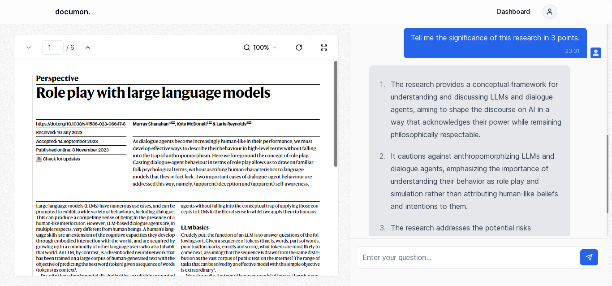

# Documon

Documon harnesses the power of artificial intelligence to transform the way you interact with PDF documents. Seamlessly chat with your PDFs and get smart context summaries of what they actually say. Exploring a document and finding what you need becomes a breeze.

## Screenshot



<p align="center">
  <a href="https://documon.nabarun.app"><strong>View Project »</strong></a>
</p>

## Running Locally

This application requires Node.js v24+.

### Cloning the repository to the local machine:

```bash
git clone https://github.com/nabarvn/documon.git
cd documon
```

### Installing the dependencies:

```bash
pnpm install
```

### Setting up the `.env` file:

```bash
cp .env.example .env
```

> [!IMPORTANT]
> Ensure you populate the variables with your respective API keys and configuration values before proceeding.

### Configuring Prisma:

```bash
pnpm prisma generate
```

```bash
pnpm prisma db push
```

### Forwarding Stripe webhooks:

Install the [Stripe CLI](https://docs.stripe.com/stripe-cli) and log in:

```bash
stripe login
```

In a second terminal, forward events to the local app and leave that process running:

```bash
stripe listen --events checkout.session.completed,customer.subscription.updated,customer.subscription.deleted --forward-to localhost:3000/api/webhooks/stripe
```

The CLI prints a `whsec_...` secret. Put that value in `STRIPE_WEBHOOK_SECRET` in `.env` before starting the app.

### Running the application:

```bash
pnpm dev
```

## Tech Stack

- **Language**: [TypeScript](https://www.typescriptlang.org)
- **Framework**: [Next.js](https://nextjs.org)
- **Styling**: [Tailwind CSS](https://tailwindcss.com)
- **Analytics**: [Vercel Analytics](https://vercel.com/analytics)
- **State Management**: [React Query](https://www.npmjs.com/package/@tanstack/react-query)
- **ORM Toolkit**: [Prisma](https://www.prisma.io/docs/concepts/overview/what-is-prisma)
- **LLM Provider**: [OpenAI](https://platform.openai.com/docs/overview)
- **Vector Database**: [Pinecone](https://docs.pinecone.io/docs/overview)
- **Memory Builder**: [LangChain.js](https://js.langchain.com/docs/get_started/introduction)
- **Rate Limiter**: [Upstash](https://docs.upstash.com/redis)
- **Postgres Database**: [Neon](https://neon.tech/docs/introduction/about)
- **Authentication**: [Kinde](https://kinde.com/docs/developer-tools/nextjs-sdk)
- **File Hosting**: [UploadThing](https://docs.uploadthing.com)
- **API Typesafety**: [tRPC](https://trpc.io/docs)
- **Payments**: [Stripe](https://stripe.com/docs/payments)
- **Deployment**: [Vercel](https://vercel.com)

## Credits

Learned a ton while building this project. All thanks to Josh for the next level (no pun intended) tutorial!

<hr />

<div align="center">Don't forget to leave a STAR 🌟</div>
